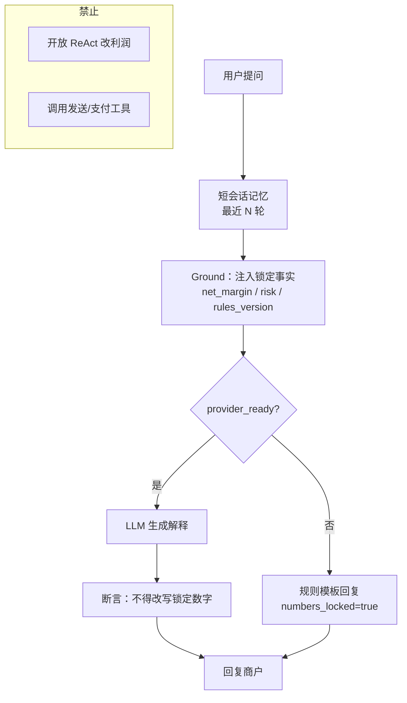

# 架构图 01 · Chatbot — Grounded Conversational RAG

挂点：`AI/support.support_reply` · `/ai/chat` · copilot  
主扛：**ActR** · **N% 可解释**

---

## 架构图



```text
用户 → 装载 facts（只读）→ LLM 或规则降级 → 数字锁校验 → 回复
```

---

## 为什么选它

| 需求 | Grounded RAG 怎么满足 |
| --- | --- |
| 金额可审计 | 数字来自规则快照，模型只引用 |
| 对话要连贯 | 短记忆够解释报告，不需要长规划 |
| 关混元仍可用 | 规则模板降级路径已存在 |

## 和其他架构相比

| 备选 | 不选原因 |
| --- | --- |
| **开放 ReAct / Tool Agent** | 模型可能调「改利润」「重算」类工具，破坏 N% 可信与 `LockAcc` |
| **纯 Prompt 无 Ground** | 易幻觉编造利润/订单，ActR 建立在错误数字上 |
| **Multi-agent 辩论** | 客服场景延迟与成本过高；无助于八率 |
| **Plan-Execute** | 无多步任务；一问一答 + 锁定块即可 |
| **Agentic RAG（可写回）** | 检索结果若可改库，违反「模型不改数」 |

**一句话**：客服只要「说清楚锁定数字」，不要「想办法改系统」。
