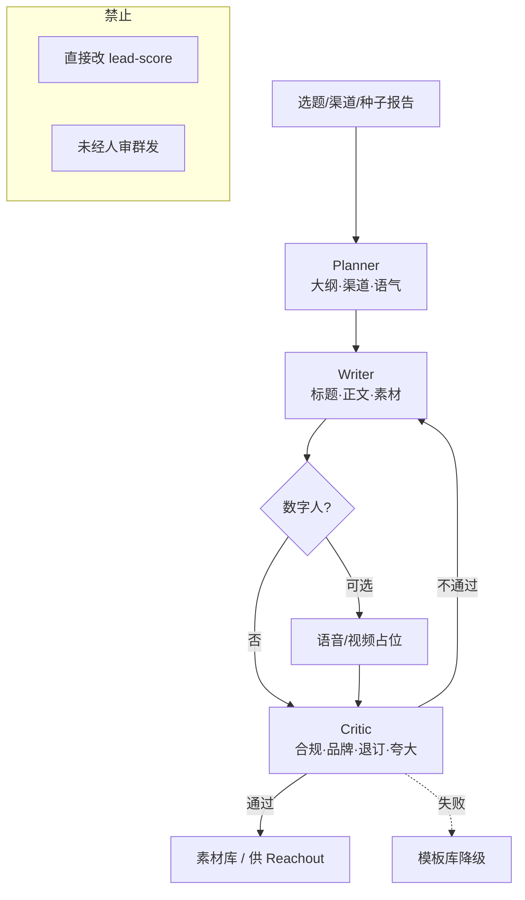

# 架构图 03 · 内容工厂 — Plan → Draft → Critique

挂点：B7 · `/content/*` · 数字人占位  
主扛：**OR** · **AR** · **ActR**（供料，不进账本）

---

## 架构图



```text
Brief → Plan → Draft（±数字人）→ Critique 循环 → 入库供 ④ · 不入线索分
```

---

## 为什么选它

| 需求 | Plan-Draft-Critique 怎么满足 |
| --- | --- |
| 打开率 OR | 多角色打磨标题/钩子，优于单次生成 |
| 合规 | Critic 闸门挡夸大、违禁、缺退订 |
| 与主链解耦 | 只供料 ④；失败用模板，不堵 LeadT |

## 和其他架构相比

| 备选 | 不选原因 |
| --- | --- |
| **单次 Prompt 出稿** | 无自检；合规与 OR 波动大 |
| **开放 ReAct 发帖** | 易自动外发，踩触达/投诉红线 |
| **HITL 全步人审** | 内容产能要高；人审留给发送（④⑤），此处 Critic 自动化 + 可抽检 |
| **Multi-agent 无 Critique** | 只有 Writer 并行无质量门，OR 不稳 |
| **Fixed Flow 无循环** | 内容需要「不过就重写」；固定一步不够 |

**一句话**：内容要「写得好且过合规」，用角色流水线；发送权仍不在本 Bot。
