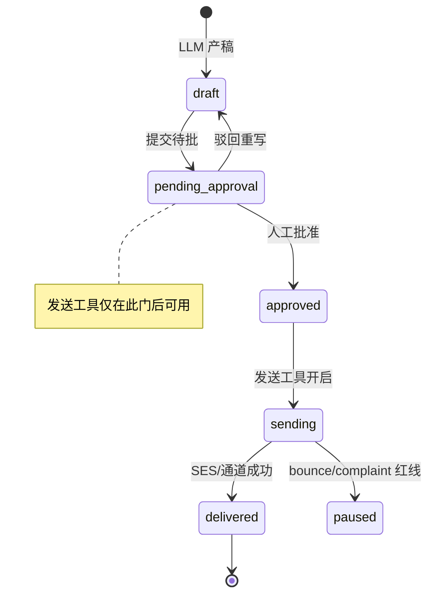
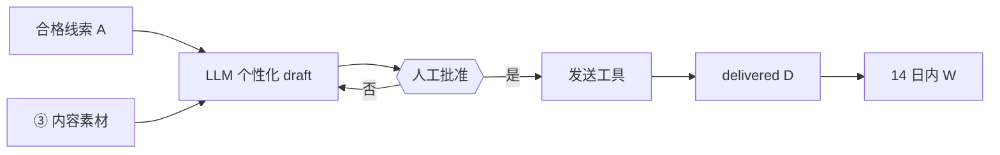

# 架构图 04 · Reachout — HITL Workflow Agent

挂点：Campaign `draft → pending_approval → approved → sending`  
主扛：**TR≥95%** · **OR** · **AR≥8%** · **AcqT≤3天**

---

## 架构图

---

## 为什么选它

| 需求 | HITL Workflow 怎么满足 |
| --- | --- |
| 硬约束「AI→人审→发送」 | 状态机强制；无批准无 Send tool |
| TR / 投诉红线 | 红线可暂停状态；Agent 不能绕过 |
| AcqT | 批准后立即发；草稿可预生成 |

## 和其他架构相比

| 备选 | 不选原因 |
| --- | --- |
| **全自动 ReAct 群发** | 违反产品硬约束；投诉/合规不可接受 |
| **纯模板无 LLM** | OR/AR 弱；北星难达 8% |
| **Plan-Execute 自决发送** | 规划器若含 send，等于绕过人审 |
| **Event Sequential（召回形）** | 首波获客是批处理 campaign，不是生命周期序列 |
| **开放 Multi-agent 互发** | 责任边界不清；审计难 |

**一句话**：触达是「带人审门的工作流」，不是「会发信的聊天 Agent」。
