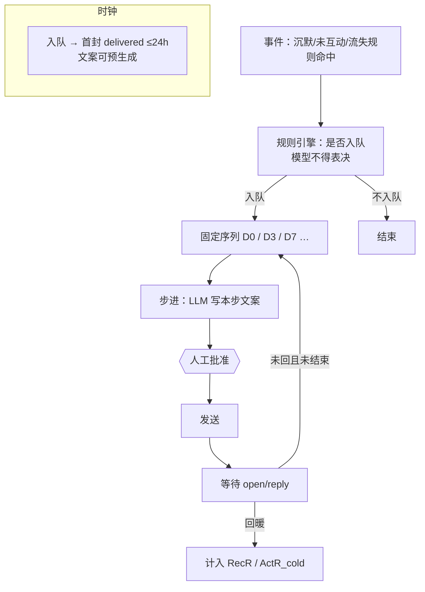

# 架构图 05 · 召回 / 冷启 — Event-triggered Sequential Agent

挂点：`recalls` · 规则入队 · 序列文案 → 批准  
主扛：**RecR** · **ActR_cold** · **ActT/RecT≤24h**

---

## 架构图



```text
规则触发 → 入队 → 序列步进(LLM 文案) → 人审 → 发 → 回暖或下一步
```

---

## 为什么选它

| 需求 | Event Sequential 怎么满足 |
| --- | --- |
| 入队可审计 | 「是否流失」只在规则，模型只写字 |
| ActT/RecT≤24h | 序列预知；可预生成 D0 稿，入队即批即发 |
| 生命周期补 N | 一周窗口内对未 W 线索补刀 |

## 和其他架构相比

| 备选 | 不选原因 |
| --- | --- |
| **模型决定是否召回** | 破坏评分/流失口径；八率不可比 |
| **与 ④ 同一批 Campaign** | 冷启/召回节奏不同；KPI 分 ActR_cold/RecR |
| **自由 ReAct「想发就发」** | 无序列、无人审 → 骚扰与投诉 |
| **Plan-Execute 动态步数** | 步数漂移导致 RecT 不可控；难评测 |
| **纯规则无 LLM** | 可发但文案弱，RecR 难达 10% |

**一句话**：召回是「规则点火的固定序列 + 人审」，不是「Agent 自己判断该不该骚扰」。
