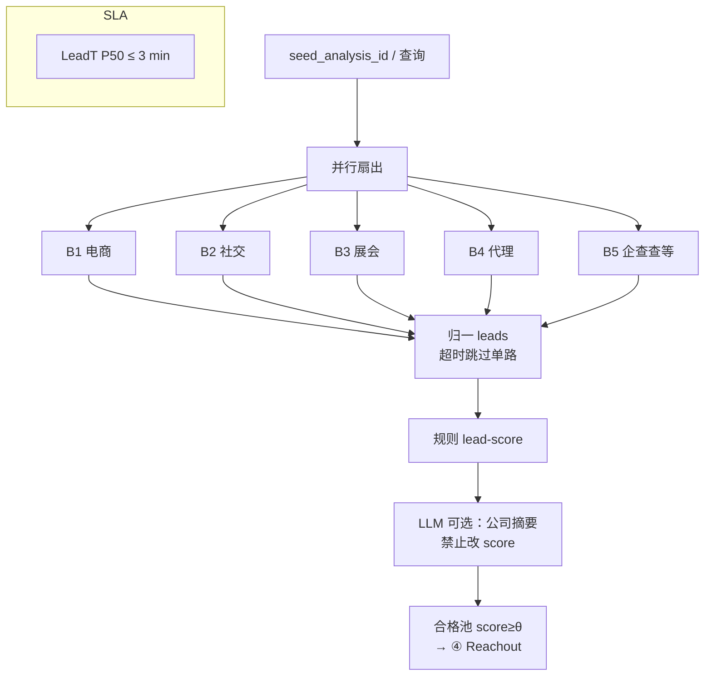

# 架构图 06 · 线索发现 — Parallel Fan-out Flow

挂点：B1–B5 · B5 智慧大脑 · `lead-score`  
主扛：**QR≥60%** · **LeadT≤3min** · 供 **AR**

---

## 架构图



```text
seed → 多 provider 并行 → 归一 → 规则打分 →（可选 LLM 补字段）→ 合格池
```

---

## 为什么选它

| 需求 | Parallel Fan-out 怎么满足 |
| --- | --- |
| LeadT≤3min | 并行 + 单路超时；避免串行 ReAct |
| QR≥60% | 分数只出规则；统一阈值 |
| 一周冲 N 的产能 | 合格池大小直接决定可触达 A |

## 和其他架构相比

| 备选 | 不选原因 |
| --- | --- |
| **串行 ReAct 逐源搜索** | 一路慢拖死 LeadT；一周产能崩 |
| **LLM 打线索分** | 不可复算；QR 漂移；与规则口径冲突 |
| **Multi-agent 每源一个辩论** | 过重；发现要快不要「商量」 |
| **Plan-Execute 动态选源** | 规划耗时；源列表产品已定（B1–B5） |
| **Fixed 单源 Flow** | 丢多通道覆盖；池子不够喂 AR |

**一句话**：发现是「并行拉网 + 规则筛」，不是「Agent 慢慢想下一步搜哪」。
