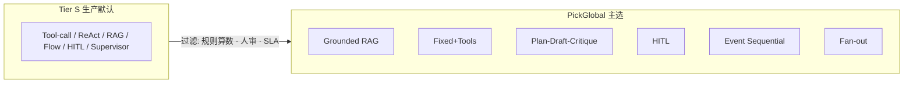

# 业界 Agent 架构百录（按流行程度 ↓）

排序依据（综合，非单一榜单）：

1. 主流框架默认形态（OpenAI Agents SDK · Anthropic tool use · LangGraph `create_react_agent` · CrewAI · AutoGen 等）
2. 2024–2026 综述 / 厂商设计模式出现频率（Tool Use · ReAct · RAG · Supervisor · HITL …）
3. 生产落地广度（客服 / 检索 / 工作流 / 编码助手）相对研究向（LATS / 辩论）的优先

说明：同名变体合并为一条；**流行 ≠ 适合 PickGlobal**。本产品主选仍见 [parts-map.md](parts-map.md)；短备选库 A01–A24 见 [catalog-backup-architectures.md](catalog-backup-architectures.md)。列 `PG`：`★`主选 · `◇`备份 · `△`条件 · `✗`默认禁用 · `—`未挂。

---

## Tier S · 几乎每家生产都在用（#1–15）

| # | 架构 | 族 | PG | 为何靠前 |
| ---: | --- | --- | --- | --- |
| 1 | **Tool-calling / Function-calling Agent** | 单 Agent · 工具 | ★② | 所有大模型厂商原生；生产默认最小 Agent |
| 2 | **ReAct**（Reason + Act 环） | 单 Agent · 推理+工具 | ◇⑥/△② | 框架默认循环；论文+SDK 双高引用 |
| 3 | **Classic RAG**（检索→生成） | RAG | ◇① | 企业问答第一形态；非强 Agent 也最多 |
| 4 | **Prompt Chaining / Fixed Workflow** | 控制流 | ★② | LangGraph/工作流产品核心；可控可审计 |
| 5 | **Agentic RAG**（自主检索/改写查询） | RAG · 自主 | △①⑥ | 从 Classic RAG 升级的主流下一跳 |
| 6 | **Grounded / Citation RAG**（带引用落地） | RAG · 对话 | ★① | 客服/合规问答标配；降低幻觉卖点 |
| 7 | **Router / Intent Classification** | 编排 | ◇入口 | 多技能入口几乎人人做 |
| 8 | **Plan-and-Execute** | 规划 | ◇③ | Anthropic/LangChain 等设计模式常列 |
| 9 | **Human-in-the-loop Workflow** | 人机 | ★④ | 企业审批/外发刚需；LangGraph checkpoint 卖点 |
| 10 | **Supervisor / Orchestrator–Workers** | 多 Agent | ◇编排 | LangGraph Supervisor 包；多域扩展默认 |
| 11 | **Parallel Fan-out / Map–Reduce** | 并行编排 | ★⑥ | 批处理与多源采集常见 |
| 12 | **Evaluator–Optimizer / Generator–Critic** | 验证环 | ★③ | 质量敏感生成的通用环 |
| 13 | **Reflection / Reflexion** | 自省 | ◇③ | 设计模式「Reflection」常进 Top 表 |
| 14 | **Structured Output / Schema Agent** | 约束解码 | ◇② | JSON Schema / tool schema 生产标配 |
| 15 | **Memory-augmented Conversational Agent** | 对话 · 记忆 | △① | Chatbot 产品标配短期/摘要记忆 |

---

## Tier A · 常见生产 / 框架一等公民（#16–35）

| # | 架构 | 族 | PG | 为何靠前 |
| ---: | --- | --- | --- | --- |
| 16 | **ReWOO / Planner-then-batch-tools** | 先规划工具 | ◇②⑥ | 减往返；相对 ReAct 的时效向变体 |
| 17 | **LLMCompiler**（并行工具图） | 工具规划 | ◇②⑥ | 学术+工程都在推并行 tool DAG |
| 18 | **State-machine / Graph Agent**（显式图） | 控制流 | ★④⑤内核 | LangGraph 本体；非「纯模型控流」 |
| 19 | **Swarm / Peer Handoffs** | 多 Agent | △①分流 | OpenAI Swarm / langgraph-swarm 热度高 |
| 20 | **Crew / Role-based Team**（CrewAI 式） | 多 Agent | △③ | 创业与原型极多 |
| 21 | **Self-Consistency / Best-of-N** | 采样 | ◇①③④ | 简单稳；编码与文案常用 |
| 22 | **Plan → Draft → Critique（多角色流水）** | 多角色 | ★③ | 内容工厂自然形态 |
| 23 | **Retrieval-as-Tool**（检索当工具） | RAG+工具 | ◇①⑥ | Agentic RAG 的实现主路径 |
| 24 | **Multi-query / HyDE RAG** | RAG 变体 | ◇① | 检索质量优化极常见 |
| 25 | **Corrective RAG (CRAG)** | RAG 变体 | △① | 检索质量门控流行论文落地 |
| 26 | **Self-RAG** | RAG 变体 | △① | 自反思是否检索 |
| 27 | **GraphRAG / Knowledge-graph RAG** | RAG · 图谱 | △⑥ | 企业知识库第二波 |
| 28 | **Event-triggered / Workflow Trigger Agent** | 事件 | ★⑤ | CRM/营销自动化与 Agent 合流 |
| 29 | **Sequential / Drip Campaign Agent** | 序列营销 | ★⑤ | 获客/召回产品原生 |
| 30 | **Guardrail / Policy Firewall Agent** | 安全 | ◇全员 | OpenAI/NVIDIA NeMo 等 Guardrails 普及 |
| 31 | **Fallback / Degraded Template Agent** | 可靠性 | ★①② | 关模型仍可用；运维必备 |
| 32 | **Caching / Semantic-cache Agent 外壳** | 成本 | ◇② | 生产降本第一刀 |
| 33 | **Streaming Tool Agent**（边想边流式） | UX | △① | Chat 产品体验标配 |
| 34 | **Computer-use / Browser Agent** | 环境动作 | ✗主链 | Anthropic CU / OpenAI Operator 热；安全重 |
| 35 | **CodeAct / Code-as-Action** | 代码动作 | ✗主链 | 数据/Dev 场景火；沙箱成本高 |

---

## Tier B · 垂直场景高频（#36–55）

| # | 架构 | 族 | PG | 为何靠前 |
| ---: | --- | --- | --- | --- |
| 36 | **SQL / Text-to-SQL Agent** | 数据 | — | BI Copilot 海量 |
| 37 | **Notebook / Data-analysis Agent** | 数据 | — | 分析助手标配 |
| 38 | **Coding Agent（repo-aware）** | 软件工程 | — | Cursor/Devin 类产品形态 |
| 39 | **PR Review / Diff Agent** | 软件工程 | — | 企业 DevEx 常见 |
| 40 | **Test-generation Agent** | 软件工程 | — | CI 旁路 |
| 41 | **Customer-support Ticket Agent** | 客服 | ◇① | 工单分流+回复 |
| 42 | **FAQ + Escalation HITL** | 客服 | ◇①④ | 低置信升人 |
| 43 | **Sales Email Copilot（draft-only）** | 销售 | ★④文案 | 写稿多、自动发少 |
| 44 | **Lead Scoring Assist（建议分）** | 销售 | ✗打分真源 | 常被误用；真分应规则 |
| 45 | **Enrichment Agent（公司/联系人补全）** | 销售 | ◇⑥ | Clay 等 GTM 工具核心 |
| 46 | **Web Research / Deep Research Agent** | 研究 | △⑥ | OpenAI Deep Research 等带动 |
| 47 | **Competitive Intel Summarizer** | 研究 | △③ | B2B 内容侧车 |
| 48 | **Document QA over Vault** | 企业知识 | ◇① | 权限+RAG |
| 49 | **Contract / Policy Review Agent** | 合规 | △③+HITL | 必须人审 |
| 50 | **PII Redaction Pre-Agent** | 安全 | ◇全员 | 进模型前清洗 |
| 51 | **Multimodal Vision+Tool Agent** | 多模态 | △A1 图 | 商品图/单据 |
| 52 | **Voice / Realtime Tool Agent** | 实时 | — | 电话机器人 |
| 53 | **Meeting Notes → CRM Agent** | 办公 | — | 纪要结构化 |
| 54 | **Calendar / Scheduling Agent** | 办公 | — | 助手类产品 |
| 55 | **Slack/Teams Ops Bot（命令+工具）** | 协作 | — | 内部自动化入口 |

---

## Tier C · 多 Agent / 编排进阶（#56–70）

| # | 架构 | 族 | PG | 为何靠前 |
| ---: | --- | --- | --- | --- |
| 56 | **Hierarchical Manager–Mid–Worker** | 层级多 Agent | △后期 | 大组织仿真；比 Supervisor 少见 |
| 57 | **Group Chat / Round-table** | 多 Agent 对话 | △实验 | AutoGen 经典；噪声大 |
| 58 | **Blackboard / Shared Scratchpad** | 协作记忆 | △⑥ | 多专家写共享板 |
| 59 | **Debate / Adversarial Agents** | 多 Agent | ✗利润 / ◇文案 | 学术热；生产慎用 |
| 60 | **Voting / Jury Ensemble** | 集成 | ◇文案 | Best-of-N 多 Agent 版 |
| 61 | **Society of Mind / Specialist Guild** | 多专家 | △ | 概念流行，实现少 |
| 62 | **MetaGPT / SOP Software Company** | 角色流水线 | — | 编码演示多 |
| 63 | **CAMEL Role-Play Pair** | 角色扮演 | △③脑暴 | 创意用 |
| 64 | **Producer–Critic–Editor Pipeline** | 内容 | ★③近亲 | 媒体工作流 |
| 65 | **A2A / Agent-to-Agent Protocol mesh** | 互通 | △平台 | A2A/Linux 基金会推 |
| 66 | **MCP Tool Hub Agent**（工具总线） | 工具平台 | ◇②⑥ | MCP 爆发；工具标准化 |
| 67 | **Sub-agent as Tool**（Agent 当工具） | 嵌套 | ◇编排 | OpenAI/Anthropic 常见模式 |
| 68 | **Saga / Compensating Workflow Agent** | 事务 | △④ | 支付/履约补偿 |
| 69 | **Queue-worker Agent（出队消费）** | 异步 | ★②⑤⑥ | 与 MQ/job 结合的真生产 |
| 70 | **Cron / Scheduled Sweep Agent** | 定时 | ◇⑤ | 召回池扫描 |

---

## Tier D · 推理搜索 / 学术转工程（#71–85）

| # | 架构 | 族 | PG | 为何靠前 |
| ---: | --- | --- | --- | --- |
| 71 | **Tree of Thoughts (ToT)** | 树搜索 | △③ | 创意/解题；延迟高 |
| 72 | **Graph of Thoughts** | 图搜索 | — | ToT 扩展；采用少 |
| 73 | **LATS**（语言 Agent 树搜索） | MCTS 类 | ✗默认 | 上限高、贵慢 |
| 74 | **Beam Search over Actions** | 搜索 | — | 规划变体 |
| 75 | **Monte-Carlo Tool Rollouts** | 搜索 | — | 少见生产 |
| 76 | **Replan-on-failure** | 规划 | △③ | Plan-Execute 加强版 |
| 77 | **Least-to-Most Prompting Agent** | 分解 | ◇② | 教学/推理 |
| 78 | **Skeleton-of-Thought → Expand** | 生成加速 | ◇③ | 延迟优化 |
| 79 | **Speculative Decoding Agent 外壳** | 系统 | — | 推理加速非架构本体 |
| 80 | **Chain-of-Verification (CoVe)** | 事实验证 | ◇① | 降幻觉 |
| 81 | **Constitutional / Critique-Revise** | 对齐 | ◇③ | 合规改写 |
| 82 | **RLHF/RLAIF Preference Loop（离线）** | 训练环 | — | 非在线 Agent；影响产品 |
| 83 | **Bandit / Contextual Router** | 路由学习 | △入口 | 多模型/多提示选择 |
| 84 | **Online A/B Prompt Agent** | 实验 | ◇③④ | 标题实验 |
| 85 | **Active Learning Labeler Agent** | 数据 | — | 标注工厂 |

---

## Tier E · 边缘 / 新兴 / 窄域（#86–100）

| # | 架构 | 族 | PG | 为何靠前（相对本段） |
| ---: | --- | --- | --- | --- |
| 86 | **World-model / Sim-to-Act Agent** | 仿真 | — | 机器人/游戏 |
| 87 | **Embodied / Robotics Skill Agent** | 具身 | — | 非 SaaS 主链 |
| 88 | **Game NPC Utility Agent** | 娱乐 | — | 垂类热 |
| 89 | **Autonomous Economic Agent（链上）** | Web3 | ✗ | 监管与安全风险 |
| 90 | **DAO Governance Proposal Agent** | Web3 | ✗ | 同上 |
| 91 | **Scientific Discovery Loop Agent** | 科研 | — | 实验室自动化 |
| 92 | **Drug/Molecule Design Agent** | 科研 | — | 强监管 |
| 93 | **Legal Citation-strict Agent** | 法律 | △+HITL | 必须引用+人审 |
| 94 | **Medical Triage Assist（非诊断定论）** | 医疗 | ✗本产品 | 合规极严 |
| 95 | **Privacy-preserving Federated Agent** | 隐私 | — | 研究向 |
| 96 | **On-device / Edge Tiny Agent** | 端侧 | — | 手机本地助手 |
| 97 | **Spec-Driven / Contract-first Agent** | 契约 | ◇合规文案 | OpenAPI/SOP 驱动 |
| 98 | **Digital-human Presentation Agent** | 多模态出镜 | △③占位 | B7 数字人 DEMO |
| 99 | **RAAS Outcome Escrow Agent**（结果对赌编排） | 商业编排 | △B9 | 验签入账；非普通 AR |
| 100 | **Open-ended Autodev / Self-improving Agent** | 元 Agent | ✗MVP | 演示多、可控少；勿接发送/账本 |

---

## 与 PickGlobal 六部件对照（流行榜 → 选用）

| 部件 | 流行榜中优先采用 | 流行但默认拒绝 |
| --- | --- | --- |
| ① Chatbot | #6 Grounded · #3 Classic RAG · #15 Memory · #31 Fallback | #2 开放 ReAct 改数 · #59 辩利润 |
| ② 选品 | #4 Fixed Flow · #1 Tool-calling · #16 ReWOO · #14 Schema | #73 LATS · #59 辩利润 · #44 LLM 真分 |
| ③ 内容 | #22 Plan-Draft-Critique · #12 Critic · #13 Reflexion · #21 Best-of-N | #2 自发布 ReAct |
| ④ Reachout | #9 HITL · #18 State-machine · #30 Guardrail · #43 draft-only | #19 Swarm 无门禁群发 · #34 Computer-use 乱点发送 |
| ⑤ 召回 | #28 Event · #29 Sequential · #70 Cron · #9 HITL | #100 自改进改入队规则 |
| ⑥ 线索 | #11 Fan-out · #45 Enrichment · #16/#17 批工具 · #66 MCP Hub | #2 串行长 ReAct · #44 模型打分当真 |

---

## 维护

- 流行度每半年可按框架默认项与综述重排；**不因流行自动改主选**。
- 新增形态先入本表末段，验证过 `AgentEnvaluate` / `AgentHarness` 再升备份或主选。
