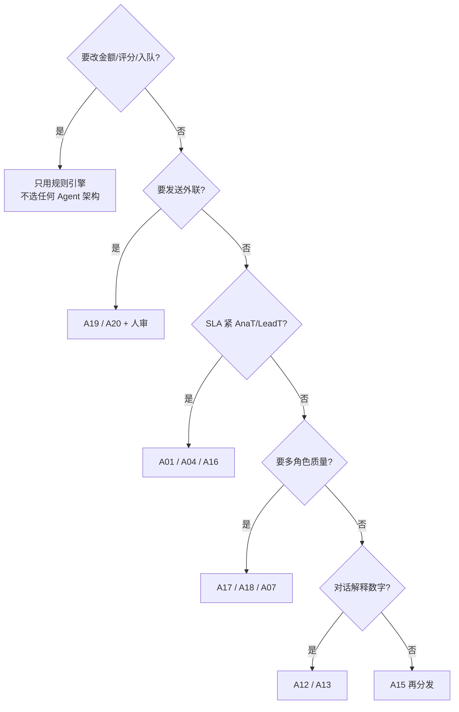

# 现行 Agent 架构备选库（≥20）

对照工业界常见形态（ReAct / Plan-Execute / Reflexion / LATS / ReWOO / Supervisor / Swarm / Agentic RAG 等）整理。  
**Pros / Cons** 相对 PickGlobal 硬约束：规则算数、人审发送、八率五时效。  
本表是**备选池（A01–A24）**；六部件主选见 [parts-map.md](parts-map.md) · 图见 [01–06](README.md)。  
业界扩表 **100 条 · 按流行度排序** → [catalog-100-by-popularity.md](catalog-100-by-popularity.md)。

图例：`★` = 已作某部件主选 · `◇` = 推荐备份 · `△` = 条件可用 · `✗` = 默认禁用（易破约束）

---

## 索引（24）

| ID | 架构 | 族 | 主选/备份 |
| --- | --- | --- | --- |
| A01 | Prompt Chaining / Fixed Flow | 单 Agent · 控制流 | ★ ② |
| A02 | Tool-calling（单次/浅层） | 单 Agent · 工具 | ★ ② 配套 |
| A03 | ReAct | 单 Agent · 推理+工具 | ◇ ⑥富化 / △ ②检索 |
| A04 | ReWOO / LLMCompiler | 单 Agent · 先规划工具 | ◇ ②⑥ |
| A05 | Plan-and-Execute | 单 Agent · 规划 | ◇ ③ |
| A06 | Plan-Execute-Reflect / Replan | 单 Agent · 规划 | △ ③ |
| A07 | Reflexion | 单 Agent · 自省 | ◇ ③ |
| A08 | Self-Consistency / Best-of-N | 单 Agent · 采样 | ◇ ①③④文案 |
| A09 | Tree of Thoughts (ToT) | 单 Agent · 搜索 | △ ③ |
| A10 | LATS | 单 Agent · 树搜索 | ✗ 默认（贵慢） |
| A11 | CodeAct | 单 Agent · 代码作动作 | ✗ 产品路径 |
| A12 | Grounded Conversational RAG | RAG · 对话 | ★ ① |
| A13 | Classic RAG（检索→生成） | RAG | ◇ ① |
| A14 | Agentic RAG | RAG · 自主检索 | △ ①⑥ · ✗ 写回金额 |
| A15 | Router / Intent Routing | 编排 | ◇ 总入口 |
| A16 | Parallel Fan-out / Map-Reduce | 编排 · 并行 | ★ ⑥ |
| A17 | Evaluator-Optimizer / Generator-Critic | 验证环 | ★ ③ 内核 |
| A18 | Plan → Draft → Critique（角色流水） | 多角色 | ★ ③ |
| A19 | HITL / Human-in-the-loop Workflow | 人机 | ★ ④ |
| A20 | Event-triggered Sequential | 事件 · 序列 | ★ ⑤ |
| A21 | Supervisor / Orchestrator-Workers | 多 Agent | ◇ 总编排 / △ ③ |
| A22 | Hierarchical Teams | 多 Agent | △ 后期平台 |
| A23 | Swarm / Handoffs | 多 Agent | △ 客服分流 |
| A24 | Multi-Agent Debate / Voting | 多 Agent | ✗ 利润 · ◇ 文案标题 A/B |

另见边缘形态（未占主 ID，可作实验）：**Blackboard**、**Group Chat**、**CAMEL Role-Play**、**Scheduled/Cron Agent**、**Spec-Driven Agent**。

---

## 逐项 Pros / Cons

### A01 · Prompt Chaining / Fixed Flow ★②

固定步骤串起来，LLM 不决定下一步。

| Pros | Cons |
| --- | --- |
| 延迟可预算（AnaT/LeadT） | 遇新异常需改代码，非自适应 |
| 可审计、易 harness | 探索能力弱 |
| 易插规则引擎硬步骤 | — |

### A02 · Tool-calling（浅层）★②配套

一次或少数次函数调用，无开放 Thought 环。

| Pros | Cons |
| --- | --- |
| 接货架/报价清晰 | 复杂多跳易不够 |
| 比 ReAct 更可控 | 工具描述差会选错 |

### A03 · ReAct ◇⑥富化 / △②

Thought → Act → Observe 循环直至结束。

| Pros | Cons |
| --- | --- |
| 探索未知源、补字段灵活 | 易死循环；拖垮 LeadT/AnaT |
| 可解释轨迹 | 可能绕过「只读规则」调危险工具 |
| — | 成本与幻觉路径多 |

**备份用法**：仅允许「只读 enrich」工具集；步数硬顶；禁止 send / 改分。

### A04 · ReWOO / LLMCompiler ◇②⑥

先规划全部工具调用，再批量执行，少穿插观察。

| Pros | Cons |
| --- | --- |
| 比 ReAct 少往返，利于时效 | 计划错了整批浪费 |
| 工具依赖可静态分析 | 动态分支弱于 ReAct |

### A05 · Plan-and-Execute ◇③

先出计划列表，再逐步执行（执行器可嵌 ReAct）。

| Pros | Cons |
| --- | --- |
| 适合内容选题多步 | 规划本身耗时；重算金额场景危险 |
| 失败可局部重跑 | 计划质量绑模型能力 |

### A06 · Plan-Execute-Reflect / Replan △③

执行后反思并改写剩余计划。

| Pros | Cons |
| --- | --- |
| 长任务自适应 | 更慢更贵；SLA 敏感路径慎用 |
| 失败恢复强 | 难保证可复现 |

### A07 · Reflexion ◇③

尝试 → 语言反馈记入记忆 → 带教训重试。

| Pros | Cons |
| --- | --- |
| 抬文案/合规通过率 | 记忆窗口有限；多轮贵 |
| 降幻觉相对 ReAct | 不适合实时对话主路径 |

### A08 · Self-Consistency / Best-of-N ◇①③④

多样本投票或选最优。

| Pros | Cons |
| --- | --- |
| 标题/语气更稳，可抬 OR | N 倍成本与延迟 |
| 实现简单 | 金额场景禁止「投票出利润」 |

### A09 · Tree of Thoughts △③

分支搜索思维树再择优。

| Pros | Cons |
| --- | --- |
| 创意选题深度好 | 延迟高；不适合 AnaT/LeadT |
| — | 实现与评测重 |

### A10 · LATS ✗默认

树搜索 + 价值估计 + 自省（类 MCTS）。

| Pros | Cons |
| --- | --- |
| 难题上限高 | 极贵极慢；与五时效冲突 |
| — | MVP/一周冲 N 不适用 |

### A11 · CodeAct ✗产品路径

以生成并执行代码为动作。

| Pros | Cons |
| --- | --- |
| 适合数据清洗/脚本自动化 | 沙箱与安全成本高 |
| — | 跨境获客主链非代码任务 |

### A12 · Grounded Conversational RAG ★①

对话 + 只读事实块（锁定数字）+ 短记忆。

| Pros | Cons |
| --- | --- |
| N% 可信；降级友好 | 无事实时能力天花板低 |
| 对齐客服场景 | 复杂多工具任务弱 |

### A13 · Classic RAG ◇①

检索文档再一次性生成（非 Agent 环）。

| Pros | Cons |
| --- | --- |
| 简单稳、延迟低 | 检索策略钝；跟不上多跳追问 |
| 易缓存 FAQ/帮助文档 | 无工具调用 |

### A14 · Agentic RAG △①⑥

模型自主决定检索次数/查询改写。

| Pros | Cons |
| --- | --- |
| 难查询补召回 | 延迟不可控；若写回库则违规 |
| — | **禁止**用于改利润/改分 |

### A15 · Router / Intent Routing ◇总入口

分类后转发到专用 Agent/模型。

| Pros | Cons |
| --- | --- |
| 一台门面拆六部件 | 路由错则整链错 |
| 成本可控（小模型路由） | 需维护意图体系 |

### A16 · Parallel Fan-out / Map-Reduce ★⑥

并行工人 + 确定性聚合。

| Pros | Cons |
| --- | --- |
| LeadT 友好；单路可超时跳过 | 聚合逻辑要手写 |
| 通道扩展简单 | 无「聪明调度」时可能浪费配额 |

### A17 · Evaluator-Optimizer / Generator-Critic ★③内核

生成 → 评分/批评 → 再生成。

| Pros | Cons |
| --- | --- |
| 合规与 OR 可闸 | 双模型成本；可能震荡 |
| 与人审解耦 | 评测器偏见 |

### A18 · Plan → Draft → Critique ★③

多角色流水（Planner/Writer/Critic）。

| Pros | Cons |
| --- | --- |
| 分工清晰；可挂数字人 | 编排复杂度高于单 Critic 环 |
| 供料不进账本 | 角色间上下文膨胀 |

### A19 · HITL Workflow ★④

状态机；关键动作等人。

| Pros | Cons |
| --- | --- |
| 满足触达硬约束；可审计 | 人审是 AcqT 瓶颈 |
| 红线可挂起 | 自动化上限受门禁 |

### A20 · Event-triggered Sequential ★⑤

规则/事件点火 + 固定步序 +（可选）每步 LLM。

| Pros | Cons |
| --- | --- |
| ActT/RecT 可预算；入队可审计 | 序列僵硬，难个性化步数 |
| 与 ④ KPI 分离 | 事件风暴需限流 |

### A21 · Supervisor / Orchestrator-Workers ◇总编排

中心经理派活给工人并汇总。

| Pros | Cons |
| --- | --- |
| 适合「一周冲 N」总控台 | 经理幻觉会乱派 send/改数 |
| 工人可复用 ①–⑥ | 单点；调试难 |

**备份用法**：Supervisor **只编排**，工人仍是本表主选；发送/改数工具不交给经理。

### A22 · Hierarchical Teams △后期

经理套经理。

| Pros | Cons |
| --- | --- |
| 大规模多租户/多市场 | 过重；MVP 不必 |
| — | 延迟与费用叠乘 |

### A23 · Swarm / Handoffs △客服分流

对等移交对话所有权，无中心经理。

| Pros | Cons |
| --- | --- |
| 客服多技能分流自然 | 移交图要严；易丢上下文 |
| — | 不适合金额主链 |

### A24 · Multi-Agent Debate / Voting ✗利润 · ◇文案 A/B

多角色争论再投票。

| Pros | Cons |
| --- | --- |
| 标题/话术 A/B 可抬 OR | **禁止**辩论出利润或是否流失 |
| — | 贵、慢、难复现 |

---

## 边缘备选（实验，不占主 ID）

| 名称 | Pros | Cons | 何时试 |
| --- | --- | --- | --- |
| Blackboard | 多专家写共享板 | 一致性难 | 富化多源摘要 |
| Group Chat | 协作直观 | 闲聊噪声 | 内部评审内容 |
| CAMEL Role-Play | 角色对话出创意 | 不可控外发 | 内容头脑风暴 |
| Scheduled/Cron Agent | 准时扫召回池 | 与业务 cron 重复 | 补 ActT/RecT |
| Spec-Driven / SOP Agent | 契约强 | 写 spec 成本 | 合规文案 |

---

## 相对六部件：主选 vs 备份（摘要）

| 部件 | 主选 | 备份（按推荐序） | 禁用 |
| --- | --- | --- | --- |
| ① Chatbot | A12 Grounded RAG | A13 Classic RAG → A08 Best-of-N（话术）→ A14 Agentic RAG（只读）→ A23 Handoff 分流 | A03 开放工具改数 · A24 辩利润 |
| ② 选品 | A01+A02 Fixed+Tools | A04 ReWOO → A03 受限 ReAct（只检索）→ A15 Router 多市场 | A10 LATS · A24 辩利润 · A14 写回价 |
| ③ 内容 | A18 / A17 | A05 Plan-Exec → A07 Reflexion → A08/A09 → A21 Supervisor 管多渠道 | A19 把发送权下放内容 Bot · A03 自发布 |
| ④ Reachout | A19 HITL | A20 序列化跟进（次触达）→ A08 标题 Best-of-N → A17 稿件自检 | 无门禁 ReAct/Swarm 群发 |
| ⑤ 召回 | A20 Event Sequential | A19 同态人审 → Cron 触发 → A07 文案 Reflexion | 模型自决入队 · A24 辩是否流失 |
| ⑥ 线索 | A16 Fan-out | A04 ReWOO 批工具 → A03 受限 enrich → A14 只读检索 → A21 分通道工人 | LLM 打分 · 串行长 ReAct |

---

## 选用决策速查

完整条目与六部件挂接以 [parts-map.md](parts-map.md) 备份表为准；评测见 `AgentEnvaluate/`，夹具见 `AgentHarness/`。
