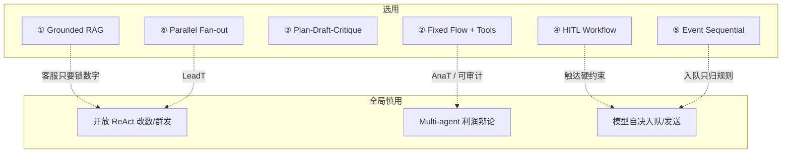
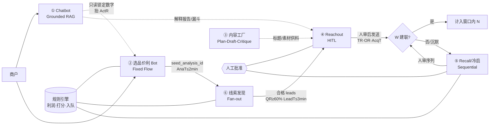

# AgentArchitect · 部件 → 架构映射

目标：服务 [project.md](../../../project.md) **八率 + 五时效**。金额 / 评分 / 是否流失只由规则引擎；模型只解释与写文案；触达必须人工批准。

现有代码：`AI/support.py`（客服）、`AI/selection.py`（检索词）、规则算数在 `app/services/profit.py` / `algorithm/*`。本目录定「该用哪种 Agent 架构」，不改公式。索引见 [README.md](README.md)。

---

## 映射表

| # | 部件 | 产品落点 | 推荐 AI 架构 | 主扛 KPI | 架构图与选型 |
| --- | --- | --- | --- | --- | --- |
| 1 | Chatbot / 工作台客服 | `/ai/chat` · copilot · `AI/support` | **Grounded Conversational RAG**（数字锁定 + 短会话记忆） | ActR · N% 可解释 | [01](01-chatbot.md) |
| 2 | 选品 · 价/利分析搜索 Bot | A1–A4 · `AI/selection` · `selection-assist` · `pg-rules` | **Fixed Flow + Tool-calling**（NL→检索→规则算数→LLM 只解释） | N% · AnaT · ActR | [02](02-selection.md) |
| 3 | 获客 · 内容工厂 Bot | B7 Content Factory · `/content/*` | **Plan → Draft → Critique**（角色分工；合规闸门） | OR · AR · ActR | [03](03-content-factory.md) |
| 4 | 获客 · 触达 / Reachout Bot | Campaign 草稿 → 批准 → 发送 | **HITL Workflow Agent**（写稿可自动，发送必须人审） | TR · OR · AR · AcqT | [04](04-reachout.md) |
| 5 | 获客 · 召回 Bot | Recall · 冷启文案 | **Event-triggered Sequential Agent**（规则入队 → 序列文案 → 批准） | RecR · RecT · ActR_cold · ActT | [05](05-recall.md) |
| 6 | 获客 · 线索发现 / 富化 Bot | B1–B5 发现 · B5 智慧大脑 · `lead-score` | **Parallel Fan-out Flow**（多 provider 并行 → 归一 → 规则打分；LLM 只补字段） | QR · LeadT · AR | [06](06-lead-discovery.md) |

### 选型总览（相对常见 Agent 形态）



| 场景压力 | 优先架构族 | 避免 |
| --- | --- | --- |
| 数字可信 · 对话 | Grounded RAG | 无 Ground 的闲聊 / 可写回 RAG |
| 时效 SLA（AnaT/LeadT） | Fixed / Fan-out Flow | 长 ReAct · Plan-Reflect |
| 合规外发 | HITL / Event+人审 | 全自动发送 Agent |
| 文案质量 | Plan-Draft-Critique | 单次 Prompt 直发 |

### 主选 × 备份（现行 ≥20 架构池）

完整 24 项 Pros/Cons → **[catalog-backup-architectures.md](catalog-backup-architectures.md)**（A01–A24 + 边缘形态）。

| 部件 | 主选（ID） | 备份（推荐序） | 明确禁用 |
| --- | --- | --- | --- |
| ① Chatbot | **A12** Grounded Conversational RAG | **A13** Classic RAG → **A08** Best-of-N（话术）→ **A14** Agentic RAG（只读）→ **A23** Handoff 分流 | A03 开放改数工具 · A24 辩利润 |
| ② 选品价利 | **A01+A02** Fixed Flow + Tool-calling | **A04** ReWOO/LLMCompiler → **A03** 受限 ReAct（只检索）→ **A15** Router 多市场 | A10 LATS · A24 辩利润 · A14 写回价 |
| ③ 内容工厂 | **A18** Plan→Draft→Critique（内核 **A17**） | **A05** Plan-and-Execute → **A07** Reflexion → **A08/A09** → **A21** Supervisor 管多渠道 | 内容 Bot 自带发送 · 开放 ReAct 自发布 |
| ④ Reachout | **A19** HITL Workflow | **A20** 序列化跟进（次触达）→ **A08** 标题 Best-of-N → **A17** 稿件自检 | 无门禁 ReAct / Swarm 群发 |
| ⑤ 召回/冷启 | **A20** Event-triggered Sequential | **A19** 同态人审 → Cron/Scheduled → **A07** 文案 Reflexion | 模型自决入队 · A24 辩是否流失 |
| ⑥ 线索发现 | **A16** Parallel Fan-out | **A04** ReWOO 批工具 → **A03** 受限 enrich → **A14** 只读检索 → **A21** 分通道工人 | LLM 打分 · 串行长 ReAct |

总入口可选 **A15 Router** 或薄 **A21 Supervisor**（只编排，不持有 send/改数工具）。一周冲 N 时备份切换不得放松人审与规则算数。

---

## 分部件说明

### 1. Chatbot — Grounded Conversational RAG

- **形态**：单轮/多轮对话；检索「锁定事实」（报告利润、风险、`rules_version`），再生成回答。
- **不要**：开放 ReAct 随意调改数工具；不要让模型重算利润。
- **降级**：无钥匙 / 失败 → 规则模板说明（已有 `support_reply`）。
- **为何**：抬 **ActR**（会解释才会点一键获客）；守住 **N%** 可信。
- **备份**：A13（帮助文档 FAQ）→ A08（多样本稳话术）→ A14 只读多跳检索；图与对比见 [01-chatbot.md](01-chatbot.md)。

### 2. 选品价利搜索 Bot — Fixed Flow + Tool-calling

- **形态**：固定流水线，禁止自由规划绕过规则。
  1. LLM 提炼检索词（`refine_need`）
  2. Tools：货架 / 目录 / 报价源
  3. **规则引擎**算 N / 税 / 时效 / 风险
  4. LLM 只写解释与排序说明
- **不要**：Multi-agent 辩论利润；不要 Agentic RAG 改金额。
- **时效**：**AnaT ≤ 2 min** → 流水线短、可缓存、可并行货架，禁止长反思环。
- **备份**：工具步变多时用 **A04 ReWOO** 一次规划调用；仅检索探索可短 **A03**（步数顶死）。见 [02-selection.md](02-selection.md)。

### 3. 内容工厂 Bot — Plan → Draft → Critique

- **形态**：Planner 定选题/渠道 → Writer 出稿 → Critic（合规 / 品牌 / 退订）→ 人工或开关发布。
- **可配**：多模态数字人占位挂在 Writer 后；失败降级模板库。
- **为何**：给 B1–B5 供料，抬 **OR / AR**；不进账本、不直接改线索分。
- **备份**：通道多时 **A05/A07**；标题打磨 **A08/A09**；多品牌线用 **A21** 只管选题工人。见 [03-content-factory.md](03-content-factory.md)。

### 4. Reachout Bot — HITL Workflow Agent

- **形态**：状态机驱动的工作流 Agent：`draft → pending_approval → approved → sending`。
- LLM 只生成 `draft`；**发送工具对人审门禁开放**。
- **为何**：硬约束「AI 生成 → 人工批准 → 发送」；扛 **TR ≥95%**、**OR**、北星 **AR ≥8%**、**AcqT ≤3 天**。
- **红线**：bounce / complaint 触发限流，Agent 不得绕过。
- **备份**：二次跟进可借用 **A20** 步序；稿件侧 **A08/A17**；**不得**去掉人审门。见 [04-reachout.md](04-reachout.md)。

### 5. Recall Bot — Event-triggered Sequential Agent

- **形态**：规则判定冷启/流失入队 → 固定触达序列（D0 / D3 / …）→ 每步 LLM 写一封 → 批准后发。
- **不要**：模型决定「是否流失」或改评分；入队条件只在规则。
- **为何**：**RecR / ActR_cold**；**RecT / ActT ≤ 24 h**（入队到首封 delivered 要快，文案可预生成）。
- **备份**：发送门与 ④ 同用 **A19**；文案迭代 **A07**；定时扫描用 Scheduled/Cron（边缘）。见 [05-recall.md](05-recall.md)。

### 6. 线索发现 / 富化 Bot — Parallel Fan-out Flow

- **形态**：按通道扇出调 provider（电商/社交/展会/代理/企查查等）→ 归一 `leads` → **规则 `lead-score`** → LLM 可选补公司摘要等非评分字段。
- **不要**：用 ReAct 串行拖慢发现；**LeadT ≤ 3 min** 要求并行 + 超时跳过单路。
- **为何**：扛 **QR ≥60%**，为北星 **AR** 供合格分子。
- **备份**：调用编排用 **A04**；单条富化短 **A03**；摘要检索 **A14 只读**。见 [06-lead-discovery.md](06-lead-discovery.md)。

---

## 架构选用原则（对齐八率五时效）

| 原则 | 含义 |
| --- | --- |
| 算数与入队用规则 | N%、QR、是否召回入队不交给模型 |
| 时效敏感用 Flow，不用长 ReAct | AnaT / LeadT 禁止无界反思环 |
| 触达类必须 HITL | Reachout / Recall / 冷启发送 |
| 内容类可用多角色 | Content Factory 可 Plan-Draft-Critique |
| 对话类必须 Grounded | Chatbot 只读锁定数字 |
| 失败可降级 | 关混元仍能出数、出模板文案 |

## 明确不放进 MVP Agent 的

| 能力 | 原因 |
| --- | --- |
| 开放 `POST /ai/agent` 通用 Agent | 开关 `ai.agent` 占位；易越权改数/群发 |
| 模型自决发送 / 自决流失 | 违反触达与规则硬约束 |
| 利润 Multi-agent 辩论 | 破坏可审计与 AnaT |

---

## 一周获 N 客户 · Agent 调用关系

目标：**7×24h** 内帮商户拿到 **N 个可对话客户**（`replied` / 约见等，去重）。六类 Agent 不是并联闲聊，而是「选品锁目标 → 扩合格池 → 供料 → 人审触达 → 未回则召回」；Chatbot 旁路答疑，不改数、不代发。普通漏斗北星 **AR=W/D≥8%**；若走 **RAAS 对赌**，同一套调用链，结算单列、`exclude_from_ar`，未达标不付（口径见 [AgentEnvaluate/01-business-kpi.md](../AgentEnvaluate/01-business-kpi.md)）。

### 总调用关系（主链）



### 一周节奏（谁先谁后）

```mermaid
sequenceDiagram
  participant 商户
  participant 选品②
  participant 线索⑥
  participant 内容③
  participant 触达④
  participant 召回⑤
  participant 规则
  商户->>选品②: D0 需求/导入
  选品②->>规则: 算 N%/税/风险
  选品②-->>商户: 报告 + 一键获客
  商户->>线索⑥: 带 seed 开发现
  线索⑥->>规则: lead-score
  并行 内容③: 预产标题/素材
  线索⑥-->>触达④: 合格池 A
  内容③-->>触达④: 文案素材
  触达④-->>商户: draft 待批
  商户->>触达④: 批准发送
  Note over 触达④: D0–D3 冲首波 W<br/>冲 AcqT≤3天
  触达④->>召回⑤: 未回复入队(规则)
  召回⑤-->>商户: 序列稿待批
  商户->>召回⑤: 批准
  Note over 选品②,召回⑤: 窗口 7 日末: DeliveredDialogs≥N 才过 RAAS 对赌
```

### 调用语义

目标不是「多叫几次模型」，而是在窗口内把去重后的 **W** 推到 **≥ N**。

**② 选品**最先被调：NL→货架工具→**规则算利润**→LLM 只解释。输出带 `seed_analysis_id`，保证后面找的人与「值得卖」的品一致，并扛住 **AnaT≤2min**、**N%**。**① Chatbot** 只读锁定数字，回答「为何推荐/如何获客」，抬 **ActR**，永不写库改分、永不发送。

商户一点「一键获客」，主调用切到 **⑥ 线索 Fan-out**：B1–B5 等 provider **并行**拉人、超时跳过单路，规则打分入库；LLM 最多补摘要。没有合格池，后面 Agent 再强也凑不出 N——所以 **QR·LeadT** 是一周战役的产能瓶颈。

**③ 内容工厂**与 ⑥ **并行旁路**：Plan→Draft→Critique 出标题/长文/数字人素材，**不入线索分、不入账本**，只提高 ④ 的 **OR/AR**。真正把「人」变成「客户」的是 **④ Reachout**：状态机 `draft→待批→批准→发送`；模型只产稿，**发送工具只对人审开放**，守 **TR≥95%** 与投诉红线，并在 **AcqT≤3天** 内抢首波 W。

未建联的，由**规则**（不是模型）打入 **⑤ 召回/冷启** 序列；⑤ 再调 LLM 写 D0/D3… 文案，同样人审后发，补 **ActR_cold·RecR**，并压 **ActT/RecT≤24h**。一周内可多轮「④ 主发 → ⑤ 补刀」，但 **N 只计窗口内去重成功事件**。

约束三条：**规则管数与入队，Agent 管解释与文案，人审管发送**。失败则降级模板，流水线不断。一周冲 N 的最短路径是：② 锁品 → ⑥ 灌合格池 → ③ 供打开率 → ④ 人审首发冲 W → ⑤ 规则召回补缺口；① 全程旁路加速决策，不插主链发信。

---

## 与目录的分工

| 目录 | 职责 |
| --- | --- |
| `AgentArchitect/` | 本文件 + [01–06 图](README.md) + [A01–A24 备选库](catalog-backup-architectures.md) |
| `AgentHarness/` | 跑批、回放、超时与降级夹具 → [README](../AgentHarness/README.md) |
| `AgentEnvaluate/` | 三维评测：商业八率五时效 + RAAS 对赌、技术指标、其他；按本表六类纵向拆卡 → [README](../AgentEnvaluate/README.md) |

### Harness 按架构对照

| # | 架构 | Harness |
| --- | --- | --- |
| 1 | Grounded Conversational RAG | [01-chatbot](../AgentHarness/01-chatbot.md) |
| 2 | Fixed Flow + Tool-calling | [02-selection](../AgentHarness/02-selection.md) |
| 3 | Plan → Draft → Critique | [03-content-factory](../AgentHarness/03-content-factory.md) |
| 4 | HITL Workflow Agent | [04-reachout](../AgentHarness/04-reachout.md) |
| 5 | Event-triggered Sequential | [05-recall](../AgentHarness/05-recall.md) |
| 6 | Parallel Fan-out Flow | [06-lead-discovery](../AgentHarness/06-lead-discovery.md) |
