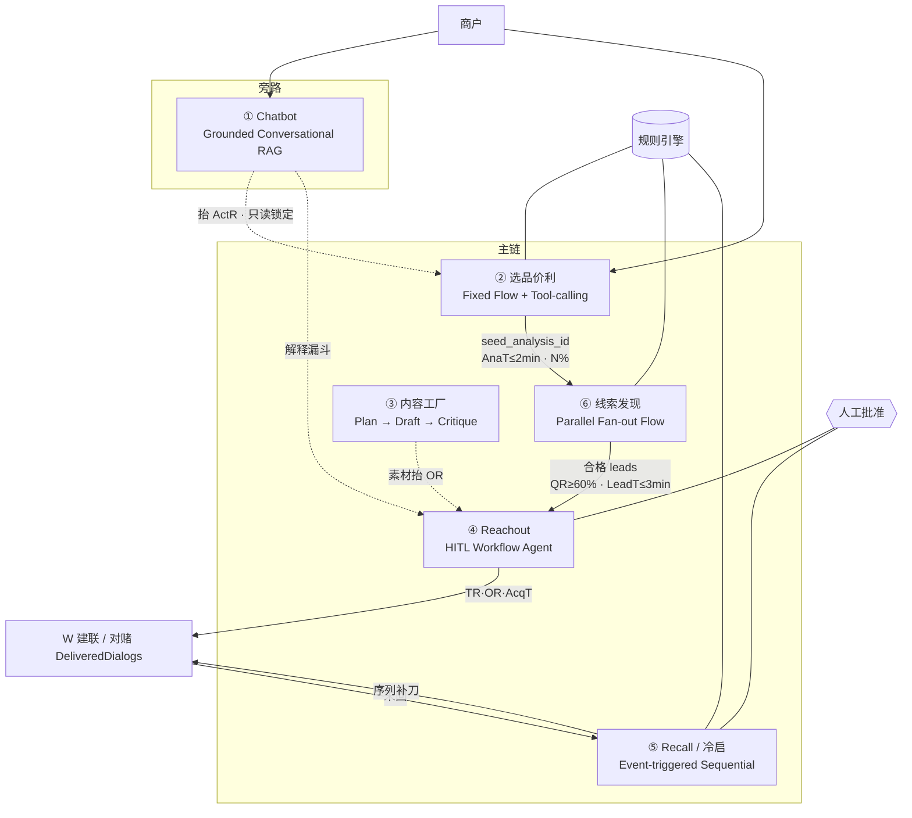
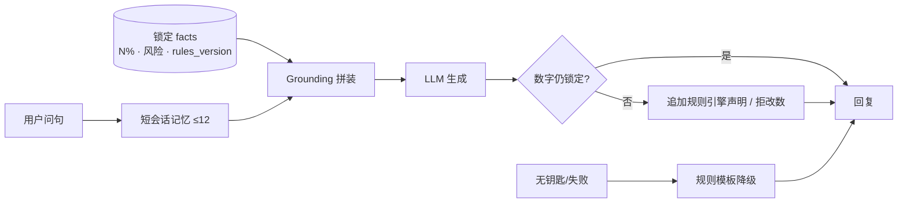
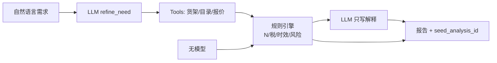
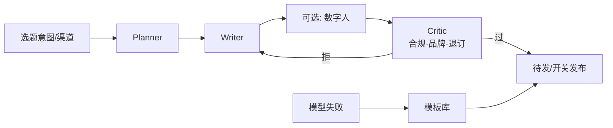
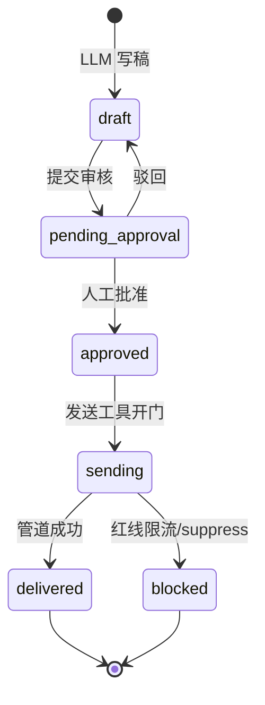
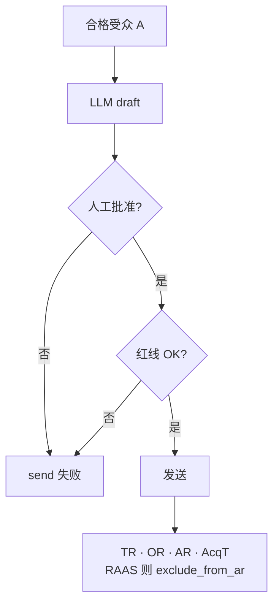
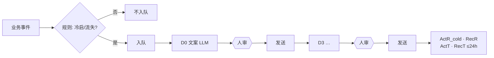
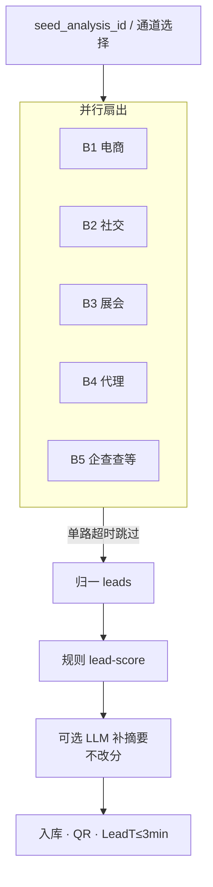
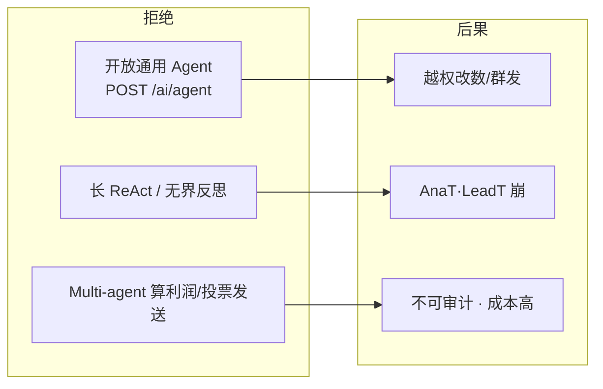

# 04 · Agent 架构图与选型理由

选型源：[AgentArchitect/parts-map.md](../AgentArchitect/parts-map.md)。  
本文件画 **六类 Agent 怎么连、每类内部怎么流**，并说明 **相对常见替代架构为何不选**。评测门槛见 [02-tech-metrics.md](02-tech-metrics.md) 与 `by-agent/`。  
夹具怎么卡这些形状：见 [harness-diagrams.md](harness-diagrams.md)。

硬约束（贯穿所有图）：

```text
规则引擎 = 利润 N% · 线索分 QR · 是否流失入队
LLM     = 解释 · 检索词 · 文案
人审    = 任何对外发送
```

---

## 0. 总图：一周冲 N / 普通 AR 主链



| 角色 | 架构一句话 |
| --- | --- |
| ① | 对话前先塞锁定 facts，再生成 |
| ② | 固定四步流水线，算数不进模型 |
| ③ | 三角色串行，Critic 是合规闸 |
| ④ | 状态机 + 发送工具对人审开门 |
| ⑤ | 规则事件入队 + 固定步进序列 |
| ⑥ | 多路并行扇出，超时丢单路 |

---

## 1. Chatbot — Grounded Conversational RAG

### 架构图



### 为何选它 · 对比

| 候选 | 结论 | 原因 |
| --- | --- | --- |
| **Grounded Conversational RAG（选）** | ✅ | 报告数字已在规则快照；对话只需「读得懂 → 敢点一键获客」抬 **ActR**，守 **N% 可信** |
| 开放 ReAct + 改数工具 | ❌ | 模型可重算/改写利润 → LockAcc 崩、不可审计 |
| 纯检索无生成 | ❌ | 体验差，ActR 起不来 |
| 长记忆 Agent 记忆库 | ❌ | MVP 不需要；成本与串租户风险更高 |
| Multi-agent 客服辩论 | ❌ | 延迟与成本无收益；仍不能改数 |

**一句话：** 客服是解释器不是计算器。

---

## 2. 选品价利 — Fixed Flow + Tool-calling

### 架构图



### 为何选它 · 对比

| 候选 | 结论 | 原因 |
| --- | --- | --- |
| **Fixed Flow + Tool-calling（选）** | ✅ | 步骤有界 → **AnaT≤2min**；N% 字节级可复算；关模型仍有 metrics |
| 开放 ReAct / Agentic RAG | ❌ | 无界反思环打爆 AnaT；易绕过规则改金额 |
| Multi-agent 利润辩论 | ❌ | 破坏可审计；同一输入 N% 不稳定；成本高 |
| 端到端 LLM 估利润 | ❌ | 与 project「金额只用规则引擎」硬冲突 |
| 纯规则无 LLM | 部分 | 能出数但检索词/解释弱 → ActR 差；故保留「只解释」段 |

**一句话：** 流水线锁路径，工具取货，规则算钱，模型说话。

---

## 3. 内容工厂 — Plan → Draft → Critique

### 架构图



### 为何选它 · 对比

| 候选 | 结论 | 原因 |
| --- | --- | --- |
| **Plan → Draft → Critique（选）** | ✅ | 内容要创意也要合规闸；Critic 专拦违禁/假承诺，抬 **OR** 且不脏 **QR/账本** |
| 单次 Prompt 出终稿 | ❌ | 缺独立合规关；退订/品牌易漏 |
| 开放 ReAct 自研选题工具 | ❌ | 不可控外链/抓取；MVP 供料即可 |
| 与线索打分同一 Agent | ❌ | 文案质量掺进 QR → 评分不可复算 |
| 自动群发一体 Agent | ❌ | 触达必须 HITL；工厂≠发送 |

**一句话：** 三角色分工，Critic 是闸，不碰发送、不碰打分。

---

## 4. Reachout — HITL Workflow Agent

### 架构图





### 为何选它 · 对比

| 候选 | 结论 | 原因 |
| --- | --- | --- |
| **HITL Workflow Agent（选）** | ✅ | 产品硬约束「AI 生成→人批→发送」；状态机可审计；扛 **TR≥95%** 与投诉红线 |
| 全自动发送 Agent | ❌ | 合规事故；complaint 红线不可控 |
| 开放 ReAct 自带 send 工具 | ❌ | 提示注入即可群发 |
| 仅模板无 LLM | 弱 | OR/AR 上不去；可作降级但不能作主路径 |
| Multi-agent「争论发不发」 | ❌ | 「发不发」只能人审+红线，不能模型投票 |

**一句话：** 模型只有笔，钥匙在人审和红线。

---

## 5. Recall / 冷启 — Event-triggered Sequential Agent

### 架构图



### 为何选它 · 对比

| 候选 | 结论 | 原因 |
| --- | --- | --- |
| **Event-triggered Sequential（选）** | ✅ | 入队条件可复算；序列步进有界 → **ActT/RecT≤24h**；文案可预生成 |
| 模型自决「是否流失」 | ❌ | RecR 分母被模型污染；不可审计 |
| 开放 ReAct 随意改序列 | ❌ | 节奏失控；P95&gt;72h 告警难守 |
| 与 Reachout 同一自由 Agent | ❌ | 冷启/召回是事件驱动，不是一次性 campaign |
| 无序列单封 | 弱 | ActR_cold / RecR 通常需要多触点 |

**一句话：** 规则决定进不进队列，模型只写第几封信。

---

## 6. 线索发现 — Parallel Fan-out Flow

### 架构图



### 为何选它 · 对比

| 候选 | 结论 | 原因 |
| --- | --- | --- |
| **Parallel Fan-out Flow（选）** | ✅ | **LeadT≤3min** 要求并行；单路挂了跳过仍有结果；QR 由规则打分可复算 |
| 串行 ReAct 逐个 provider | ❌ | 一路慢拖死整链，LeadT 必炸 |
| LLM 直接打 quality_score | ❌ | QR 不可复算；对赌/经营看板失真 |
| Multi-agent 争「谁的线索更好」 | ❌ | 延迟与不稳定；归一+规则分更稳 |
| 单 provider 同步 API | 不够 | B1–B5 多源是产品路径，必须扇出 |

**一句话：** 产能靠并行，质量靠规则分，模型最多写摘要。

---

## 7. 横向对照：我们系统性拒绝的三类架构



| 原则 | 对应架构选择 |
| --- | --- |
| 算数与入队用规则 | ② Flow / ⑤ Sequential / ⑥ Fan-out 都把「数」留在规则 |
| 时效敏感用 Flow | ② ⑥ 禁长 ReAct |
| 触达必须 HITL | ④ ⑤ 状态机 / 序列 + 人审 |
| 内容可多角色 | ③ Plan-Draft-Critique |
| 对话必须 Grounded | ① 锁定 facts |
| 失败可降级 | 六类均有模板 / 跳过单路 |

---

## 8. 和评测的衔接

| 架构图上的点 | 评测看什么 |
| --- | --- |
| 规则节点 | LockAcc · QR/N% 可复算 · 入队不可被模型改 |
| LLM 节点 | SchemaOK · GroundHit · CostTok |
| 人审节点 | HITLGate =100% |
| 并行/超时 | LeadT · DegradeOK（单路失败） |
| 红线 | NoBypass · 送达红线 |
| 一周 N / RAAS | DeliveredDialogs；`exclude_from_ar` |

跑法见 [AgentHarness](../AgentHarness/README.md)；过线表见 [02](02-tech-metrics.md) 与各 `by-agent/*`。
