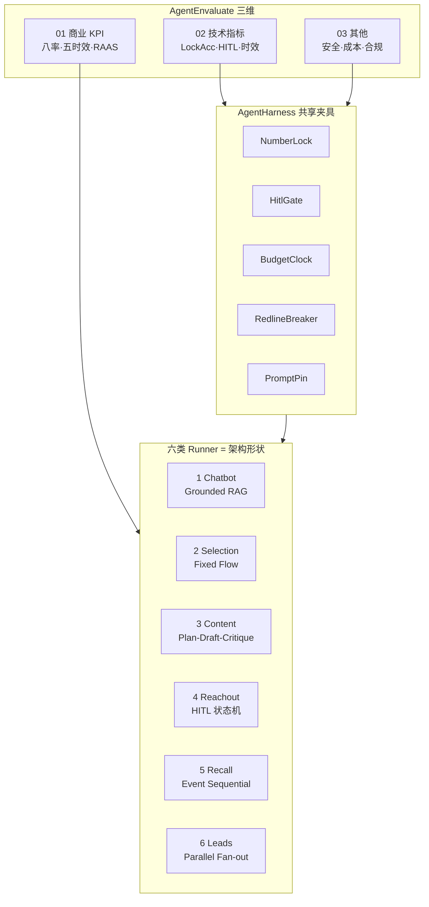
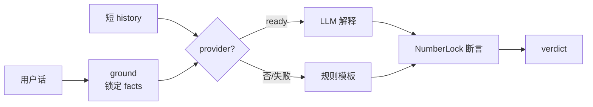
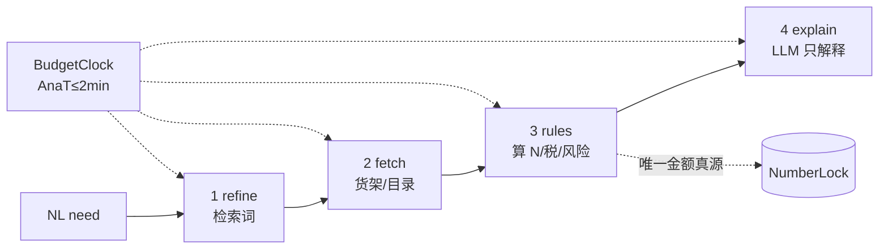
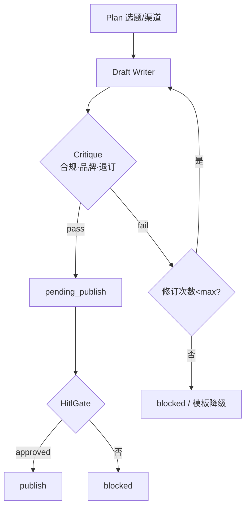
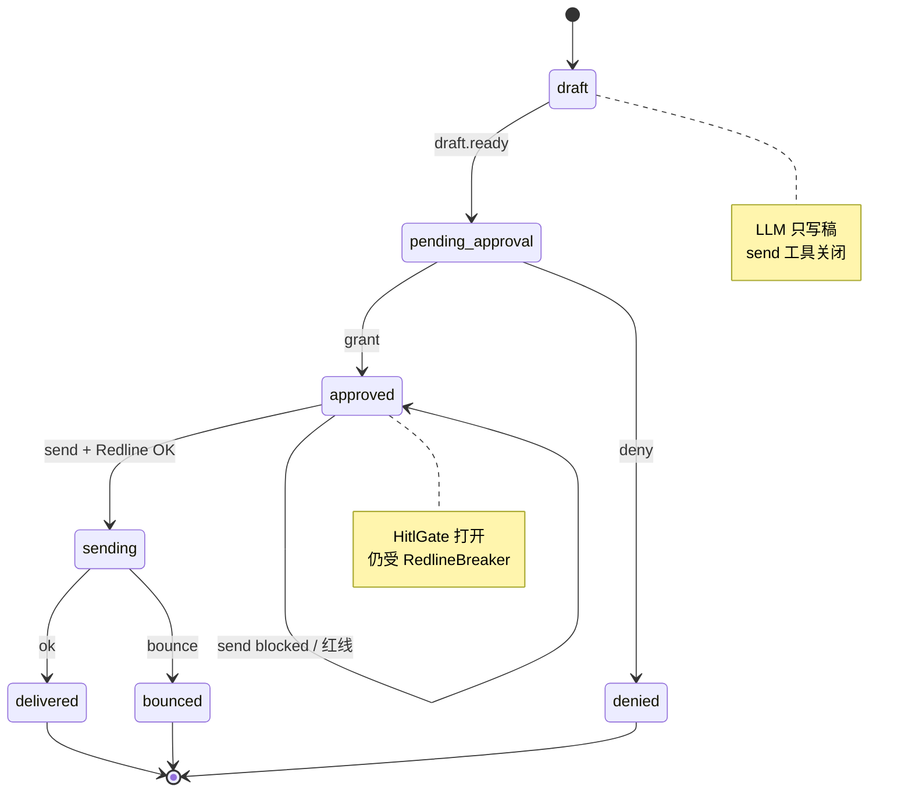
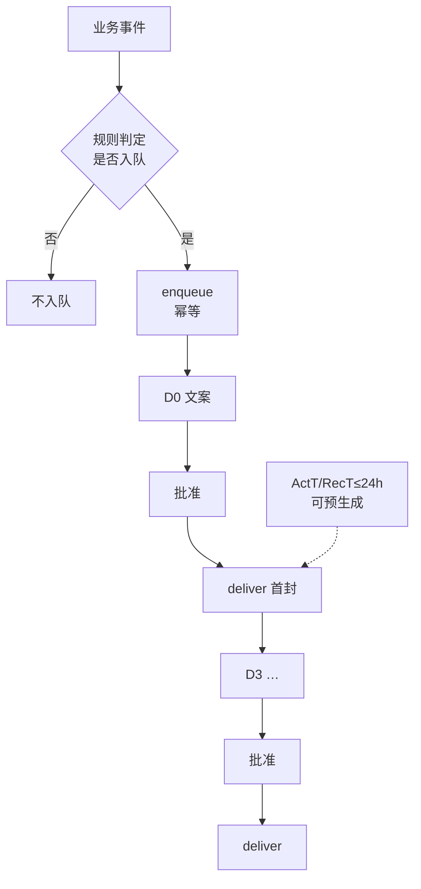
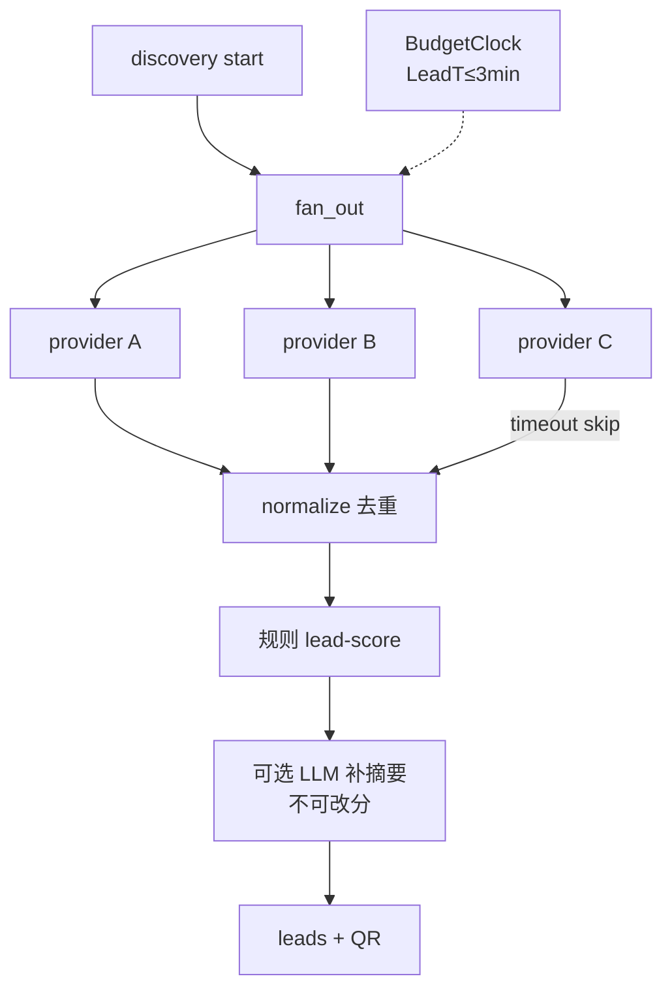

# Agent Harness 图解 · 选型理由

对齐 [02-tech-metrics.md](02-tech-metrics.md) 与 [AgentHarness](../AgentHarness/README.md)。  
**评测定「测什么」；Harness 定「怎么夹着跑」。**  
产品侧六类架构总图与「为何不选 ReAct/辩论/全自动」见 [04-architecture.md](04-architecture.md)。

---

## 0. 总览：三维 → 夹具 → 六类 Runner

| 为什么要 Harness（不是裸调 LLM） | 对应 Envaluate |
| --- | --- |
| 金额/评分必须可复算、可对抗 | `LockAcc` · `NoBypass` |
| 五时效有墙钟预算，禁无界 ReAct | `P50_Lat` · `RetryStorm` |
| 触达必须可证「未批准不能发」 | `HITLGate` |
| 关混元业务不能挂 | `DegradeOK` |
| 批测 / 回放 / 故障注入可重复 | 金标集 · 对抗集 · 故障注入 |

---

## 1. Chatbot · Grounded Conversational RAG

**为什么选它**

| 选 | 不选 | 理由 |
| --- | --- | --- |
| Grounded RAG | 开放 ReAct / 改数 Tool | 主扛 **ActR + N% 可信**；模型只能读锁定利润 |
| 短会话记忆 | 长记忆 Agent | 对话段 P50≤3s；防跨租户/注入灌爆 |
| 规则降级 | 硬失败 | `DegradeOK=100%`：关钥匙仍能解释 |

测什么：`LockAcc` · `GroundHit` · 对抗「改成 40%」。

---

## 2. 选品价利 · Fixed Flow + Tool-calling

**为什么选它**

| 选 | 不选 | 理由 |
| --- | --- | --- |
| **固定四阶段** | 自由规划 Agent | **AnaT≤2min**；阶段可预算、可缓存 |
| Tool-calling 只取货 | Agentic RAG 改金额 | `LockAcc=100%`（金额）；关模型 metrics 仍在 |
| 单次 refine | 利润 Multi-agent 辩论 | `RetryStorm≤1`；可审计 `rules_version` |

测什么：同输入 N% 字节级一致；整链计入 AnaT。

---

## 3. 内容工厂 · Plan → Draft → Critique

**为什么选它**

| 选 | 不选 | 理由 |
| --- | --- | --- |
| 三角色分工 | 单次「直接可发」生成 | 主扛 **OR**；违禁须 100% 拦截 |
| Critic 硬闸 | 仅靠 prompt「请合规」 | 可测「合规闸通过率」；状态不可标可发布 |
| 发布仍 HITL | 工厂自动群发 | 工厂≠触达；不进账本、不改线索分 |

测什么：违禁拒发；字段 SchemaOK；数字人失败不影响文稿。

---

## 4. Reachout · HITL Workflow

**为什么选它**

| 选 | 不选 | 理由 |
| --- | --- | --- |
| **状态机 + 人审** | 模型自决发送 | 产品硬约束；`HITLGate=100%` |
| 红线熔断在 send 前 | Agent「先发再说」 | TR≥95%；bounce/complaint 红线 |
| dry_run / would_send | 批测真群发 | 可回放批准序列，不污染生产 |

测什么：未批准无 delivered；红线后限流；RAAS `exclude_from_ar`。

---

## 5. Recall · Event-triggered Sequential

**为什么选它**

| 选 | 不选 | 理由 |
| --- | --- | --- |
| **规则触发 + 固定序列** | 模型决定流失/入队 | `NoBypass`；RecR / ActR_cold 分母干净 |
| 逐步 HITL | 一次批准全序列乱发 | 与触达红线一致；可测 ActT/RecT |
| 虚拟时钟 + 预生成 | 等模型当场才写首封 | P50≤24h；P95>72h 可告警 |

测什么：模型「不要召回」无效；未批准无 delivered；关模型模板序列可走完。

---

## 6. 线索发现 · Parallel Fan-out

**为什么选它**

| 选 | 不选 | 理由 |
| --- | --- | --- |
| **并行 + 单路超时跳过** | 串行 ReAct | **LeadT≤3min**；一路 5xx 不拖死整批 |
| 评分仅规则 | LLM 打 quality_score | QR≥60% 可复算；对抗「全打 99 分」 |
| 归一后再 enrich | 边想边搜无界 | SchemaOK + 去重；成本可缓存 |

测什么：并行重叠执行；超时 skipped；`channel=raas` 不进普通 AR。

---

## 选型总表（一句话）

| # | Harness 形状 | 一句话为什么 |
| --- | --- | --- |
| 1 | Grounded RAG | 解释驱动 ActR，数字必须锁死 |
| 2 | Fixed Flow | AnaT 与可审计 N% 不允许自由环 |
| 3 | Plan-Draft-Critique | OR 靠文案，发布前必须过合规闸 |
| 4 | HITL 状态机 | 北星 AR 的触达合法前提是人审 |
| 5 | Event Sequential | 生命周期率靠规则入队 + 序列 SLA |
| 6 | Parallel Fan-out | QR/LeadT 靠并行发现，分仍归规则 |

**共性拒绝**：开放 `POST /ai/agent`、模型自决发送/流失、利润辩论 Multi-agent —— 都会破坏 Envaluate 的 `NoBypass` / 五时效 / 八率口径。
